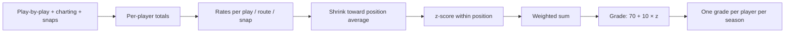

# PLAN.md — Free NFL Player Grades

A free, public, no-ads/no-donations app/site that grades every NFL player on a
0–100 scale using only free data. v1 calculations are working (`grades.py`).
This file is the spec: what we compute, why, what's weak, and what's next.

---

## 1. Data sources

| Source | What we use | Rights / notes |
|---|---|---|
| nflverse play-by-play (`load_pbp`) | EPA, success, CPOE, targets, tackles, sacks, QB hits, PBUs, INTs, FGs, punts | Code MIT. Underlying NFL facts. Credit nflverse. |
| FTN charting via nflverse (`load_ftn_charting`) | Interception-worthy throws, QB-fault sacks, drops, catchable balls | CC-BY-SA 4.0. Must credit **"FTN Data via nflverse"**. Share-alike applies if we redistribute the data. |
| Next Gen Stats via nflverse (`load_nextgen_stats`) | Rush yards over expected, QB time to throw, receiver separation, YAC over expected | NFL-published aggregates. Credit NFL Next Gen Stats. |
| Snap counts via nflverse (`load_snap_counts`) | Snap totals → estimated routes / coverage / pass-rush snaps | Sourced from Pro Football Reference. |
| PFR advanced stats via nflverse (`load_pfr_advstats`) | Coverage (targets, yards, TDs allowed), pressures, missed tackles, yards after contact, broken tackles, pressures allowed by QB | **Sourced from Pro Football Reference (Sportradar data). Check Sports Reference's data-use policy before publishing grades built on these.** This is v1's biggest licensing dependency. |
| Rosters (`load_rosters`) | Position, depth-chart position, weight, ID mapping (gsis ↔ pfr) | Facts. |

Not used (private validation only, never republished): SIS DataHub, Big Data Bowl.

---

## 2. How every grade is built



1. **Count** each player's plays and outcomes for the season to date.
2. **Rate** them: per dropback, per route, per coverage snap, etc.
3. **Shrink** small samples toward the position average:
   `rate = (player_total + k × league_rate) / (player_plays + k)`.
   Example: a WR with 2 targets and 2 big plays doesn't top the list, because
   `k` "average" targets get blended in. Bigger samples barely move.
4. **z-score** each metric within the position (top/bottom 2.5% clipped first so
   one freak game can't dominate).
5. **Weight and sum** the z-scores (weights per position below).
6. **Scale**: `grade = 70 + 10 × z(composite)`, clipped 30–99.9.
   **70 = average qualified player. Each 10 points = 1 standard deviation.**
   90+ ≈ top 2–3%.
7. **Each season stands alone (default).** A season's grades use only that
   season's games. Nothing from earlier years leaks in. An optional `--blend`
   flag mixes in last season's grade early in the year (last season counts
   like ~2 games), but it's off by default and not used on the site.

   Why: six weeks is ~20 targets for a corner, and one 40-yard catch swings
   everything. Graded over the full 2025 season, the same CB formula puts
   Surtain 1st, Stingley 3rd and McDuffie 4th, so the formula holds up. The
   noise comes from small samples, not the weights.

**Qualification thresholds** scale with team games played, so byes don't punish
anyone: QB 20 plays/game · RB 8 carries/game · WR 18 est. routes/game ·
TE 12 est. routes/game · EDGE/IDL 25 def snaps/game · LB/CB/S 30 def snaps/game ·
K 1.2 FGA/game · P 2.5 punts/game.

---

## 3. Position formulas (v1)

Signs: **+** higher is better, **−** lower is better. `k` = shrinkage strength.

### QB
| Metric | Weight | Source | k |
|---|---|---|---|
| + EPA per play (dropbacks + designed runs) | 35% | pbp `qb_epa` | 60 plays |
| + Value over average: (EPA/play − avg) × plays | 25% | pbp | — |
| + Completion % over expected (CPOE) | 15% | pbp `cpoe` | 60 att |
| + Success rate | 10% | pbp | 60 plays |
| − Interception-worthy throw rate | 10% | FTN | 100 dropbacks |
| − QB-fault sack rate | 5% | FTN | 100 dropbacks |

Value over average rewards carrying a full workload at a high level. The
near-INT and sack penalties were cut because real INTs and sacks are already
inside EPA, so the old weights double-counted them.

### RB
| Metric | Weight | Source |
|---|---|---|
| + Rush yards over expected per carry | 25% | NGS (league median if not listed) |
| + Yards after contact per carry | 20% | PFR |
| + Rush success rate | 15% | pbp |
| + Rush EPA per carry | 10% | pbp |
| + Broken tackles per touch | 10% | PFR |
| + Receiving yards per route | 15% | pbp + snaps |
| − Fumbles lost per touch | 5% | pbp |

### WR and TE (graded separately)
| Metric | Weight | Source | k |
|---|---|---|---|
| + Yards per route run | 25% | pbp + snaps | 150 routes |
| + Targets per route | 20% | pbp + snaps | 80 routes |
| + Route share (on field for % of team dropbacks) | 10% | snaps | — |
| + EPA per target (interceptions excluded) | 10% | pbp | 60 targets |
| + Catch rate over expected | 10% | pbp `cpoe` on targets | 60 targets |
| + Separation over expected | 10% | Next Gen Stats | 40 targets |
| + YAC over expected | 5% | Next Gen Stats | 25 catches |
| − Drop rate (drops ÷ catchable balls) | 10% | FTN | 60 catchable |

**Routes are estimated:** offensive snap % × team dropbacks, game by game.

- **INTs:** interceptions thrown at a receiver don't count against his EPA.
  Those are the QB's plays.
- **Role:** route share separates every-down starters from part-timers. A
  receiver who's great on 45% of dropbacks shouldn't outrank one doing it on 85%.
- **Small samples:** per-target stats get heavy shrinkage (big `k`) because they
  swing wildly on 20–30 targets.
- **Separation over expected:** NGS average separation at the throw,
  compared with what's normal for that receiver's target depth and the
  cushion DBs give him. Deep routes and press coverage naturally mean less
  separation, so raw separation alone misleads.
- **Not counted directly:** touchdowns and total receptions. TD value is
  already inside EPA, and raw totals punish players who missed games.
- **NGS coverage:** Next Gen Stats only lists receivers with 20+ targets.
  Anyone below that gets league average (0) on those two metrics.

### OL team units
| Metric | Weight | Source |
|---|---|---|
| − Pressure rate above what QB hold time predicts | 35% | PFR pressures + NGS time to throw |
| − Sacks not charted as QB's fault, per dropback | 20% | pbp + FTN |
| + Yards before contact per non-QB carry | 25% | PFR |
| − Stuff rate (non-QB runs for ≤ 0 yards) | 10% | pbp |
| + Non-QB run success rate | 10% | pbp |

### Individual OL — OT, OG, C (v1.3)
Free data never says which lineman allowed a pressure, so each lineman is
graded on what happened **in his area**, using depth charts for who plays
LT/LG/C/RG/RT and snap counts for who was on the field each game.

```
            LT ---- LG ---- C ---- RG ---- RT
 runs:   end | tackle | guard | mid | guard | tackle | end
 rush:   RDE         RDT     NT     LDT         LDE      (defense's right faces offense's left)
```

| Piece | How it's measured |
|---|---|
| **Pass pro** | Pressures by the rushers lined up across from him, minus what those rushers usually get against everyone (so facing an elite rusher isn't held against him) |
| **Run block** | Success rate and EPA of runs through his gaps, compared with the league average for that gap |
| **Penalties** | Holding, false start, illegal hands, chop block and clipping charged to him, per snap |
| **Team unit** | The team OL unit grade, because blocking is a five-man job |

Who owns what:
- **Runs:** end → tackle; tackle gap → tackle and guard split; guard gap →
  guard 60% / center 40%; middle → center 50%, guards 25% each.
- **4-3 rushers:** RDE → LT, LDE → RT; RDT → LG 70% / C 30%; LDT → RG 70% / C 30%;
  NT → C 60%, guards 20% each.
- **3-4 rushers:** the OLBs (WLB/SLB) move sides, so they're split evenly between
  both tackles; RDE/LDE split tackle and guard on their side.
- **Blitzers and DBs:** split evenly across all five.

| Metric | OT | OG | C |
|---|---|---|---|
| − Pressures over expected per 100 pass snaps (k = 150 snaps) | 40% | 25% | 20% |
| + Run success over expected through his gaps (k = 40 runs) | 15% | 25% | 25% |
| + Run EPA over expected through his gaps | 10% | 15% | 15% |
| − Penalty rate (k = 200 snaps) | 15% | 15% | 15% |
| + Team OL unit grade | 20% | 20% | 25% |

Qualify at 30 offensive snaps per team game.

### Individual OL validation — 2025 (run Nov 1, 2026)
Scripts: `validate_ol_2025.py`, `compare_pff_2025.py`.

**1. Split-half (Weeks 1–9 vs 10–18, 130 linemen)**
| Piece | r |
|---|---|
| Overall grade | 0.37 |
| Pass pro (matchup) | 0.42 |
| Run block (gaps) | 0.25 |
| Team unit | 0.47 |
| Grade vs. own linemates | 0.20 |

**2. Independent free-data check.** A ridge regression on 2025 per-play
participation (who was on the field + was the QB pressured) estimated each
lineman's pressure impact with no matchup assumptions. Agreement with our
matchup pass-pro numbers:
| Group | r |
|---|---|
| OT | 0.60 |
| OG | 0.16 |
| C | 0.23 |
| Within a line | 0.10 |

**3. Vs. PFF's published 2025 top lists** (free articles, Feb 2026).
"In our top N" counts how many of PFF's top N we also put in our top N.
| Group | Overlap with PFF's top list | Team-only baseline | Random |
|---|---|---|---|
| OT (PFF top 20) | 7 of 20 | 9 | ~6 |
| OG (top 21) | 12 of 21 | 13 | ~7 |
| C (top 11) | 7 of 11 | 7 | ~4 |

AUC for picking out PFF's top players (0.5 = coin flip):
| Piece | OT | OG | C |
|---|---|---|---|
| Our grade | 0.68 | 0.69 | 0.81 |
| Team unit | 0.72 | 0.73 | 0.81 |
| Matchup pass pro | 0.57 | 0.56 | 0.62 |
| Run success through his gaps | 0.65 | 0.65 | 0.74 |
| Penalty rate | 0.69 | 0.68 | 0.50 |

**Takeaways:**
- Free data separates good lines from bad ones. It doesn't yet separate
  linemen within the same line better than team quality alone does.
- Matchup pass-pro attribution only holds up for tackles.
- Penalties and run-gap results carry real individual signal.
- Biggest misses vs. PFF: Penei Sewell (our 25th), Andrew Thomas (57th),
  Brian O'Neill (58th), Chris Lindstrom (30th) — great players on lines that
  graded poorly or with heavy shared run credit.
- **Don't tune weights to match PFF's lists.** That would turn their grades
  into our training labels, which their terms of use forbid. Weight changes
  should come from the free-data checks (split-half and ridge), not from PFF.


**Be honest about this one:** grades correlate 0.8–0.9 with the team unit,
and teammates at the same spot usually land within ~5 points of each other.
It separates good lines from bad ones well, but within a line it's only a
rough split.

### EDGE / IDL
| Metric | EDGE | IDL | Source |
|---|---|---|---|
| + Pressures per pass-rush snap | 45% | 35% | PFR |
| + Sacks per pass-rush snap | 15% | 10% | PFR |
| + Run stops per run snap | 30% | 40% | pbp tackles on failed runs |
| − Missed tackle rate | 10% | 15% | PFR |

**Position split:** DE → EDGE; DT/NT → IDL; OLB → EDGE if pressures > targets
allowed or weight ≥ 248 lb, otherwise LB.

### LB
| Metric | Weight |
|---|---|
| + Run stops per run snap | 35% |
| − Yards allowed per coverage snap | 25% |
| − Passer rating allowed | 10% |
| + INTs + PBUs per coverage snap | 10% |
| − Missed tackle rate | 10% |
| + Pressures per pass snap | 10% |

### CB
| Metric | Weight |
|---|---|
| − Targets per coverage snap (avoided = good) | 15% |
| − Yards per target allowed | 20% |
| − Completions allowed over expected, by target depth | 20% |
| − YAC allowed per completion | 10% |
| + INTs + PBUs per target | 15% |
| − Passer rating allowed | 10% |
| − Missed tackle rate | 5% |
| + Run stops per run snap | 5% |

### S
| Metric | Weight |
|---|---|
| − Targets per coverage snap | 10% |
| − Yards per target allowed | 15% |
| − Completions allowed over expected, by target depth | 10% |
| + INTs + PBUs per target | 15% |
| − Passer rating allowed | 10% |
| + Run stops per run snap | 20% |
| − Missed tackle rate | 20% |

**Coverage is split into two separate questions:** how often a defender gets
thrown at (avoidance) and what happens when he is (efficiency). The old
"yards per coverage snap" mixed both, so being targeted got counted twice.

**Completions over expected** uses a league model of completion % by air yards
(about 73% at the line, 64% at 8 yards, 37% at 30 yards). A corner who allows
54% on 8-yard targets is covering tightly, even though the raw number looks
average.

**Coverage / pass-rush / run snaps are estimated:** defensive snaps × the
opponent's pass (or run) share in that game.

### K
Points over expected per kick (FG + XP), shrunk with k = 10.
FG make probability = logistic fit on distance using that season's kicks only.

### P
| Metric | Weight |
|---|---|
| + EPA per punt | 50% |
| + Net average (touchbacks count as −20) | 30% |
| + Inside-20 rate | 20% |

---


## 3b. How the weights are chosen (v1.5) — these override section 3's weights

`weights.json` holds the live weights; `grades.py` reads it automatically.

**Two checks, in this order:**
1. **Guardrail (free data only).** For 2023–2025, grade players on Weeks 1–9 and
   see how well that predicts Weeks 10–18 (scored on a season the fit never saw).
   A weight set may not predict worse than our original hand-set formula.
2. **Direction (experts as a guide, not a copy).** Among the sets that pass,
   use the one whose 2025 grades best agree with the expert consensus
   (`direction_check.py`): PFF's published 2025 top lists (full top 20 for
   QB/RB/OT/OG, top 11 for C, top 3 elsewhere) plus the AP All-Pro teams.
   We don't need the same players or order, just the same ballpark.

Candidates per position: the original hand-set weights, weights fitted to
predict future play (`calibrate_weights.py`), and a 50/50 mix of the two.
OL candidates were the original weights plus two lighter-matchup variants.
Selection script: `select_by_direction.py`.

**Agreement score:** take the experts' players we graded (N). "Near our top"
means inside our top N or top 25%, whichever is bigger. Score 0 means no better
than random rankings, and 1 means every expert pick is near our top.
- **On track:** 0.5 or higher
- **Partly:** 0.2 to 0.5
- **Off:** under 0.2

| Position | Weights (− = lower is better) | Chosen | Predicts 2nd half (r) | Expert agreement 2025 |
|---|---|---|---|---|
| QB | epa_play 44%, value_over_avg 12%, cpoe 8%, success 14%, −int_worthy_rate 10%, −fault_sack_rate 12% | 50/50 mix | 0.52 | 0.54 (on track) |
| RB | ryoe_att 25%, success 25%, rec_yds_per_route 25%, broken_tkl_rate 25% | elusiveness added (v1.5.1) | 0.40 (same as before) | 0.47 regular season / 0.59 with playoffs |
| WR | yds_per_route 39%, tgt_per_route 23%, route_share 8%, epa_per_target 11%, catch_over_exp 5%, separation_over_exp 7%, yac_over_exp 2%, −drop_rate 5% | 50/50 mix | 0.52 | 1.00 (on track) |
| TE | yds_per_route 12%, tgt_per_route 23%, route_share 24%, epa_per_target 19%, catch_over_exp 5%, separation_over_exp 5%, yac_over_exp 6%, −drop_rate 5% | 50/50 mix | 0.39 | 1.00 (on track) |
| OT | −pressures_oe_per_100 20%, run_succ_oe 25%, run_epa_oe 15%, −penalty_rate 20%, team_unit 20% | lighter matchup pass-pro (OL variant) |  | 0.22 (partly) |
| OG | −pressures_oe_per_100 10%, run_succ_oe 30%, run_epa_oe 20%, −penalty_rate 20%, team_unit 20% | lighter matchup pass-pro (OL variant) |  | 0.35 (partly) |
| C | −pressures_oe_per_100 10%, run_succ_oe 30%, run_epa_oe 20%, −penalty_rate 20%, team_unit 20% | lighter matchup pass-pro (OL variant) |  | 0.57 (on track) |
| EDGE | pressure_rate 48%, sack_rate 18%, run_stop_rate 28%, −missed_tkl_rate 5% | 50/50 mix | 0.33 | 1.00 (on track) |
| IDL | pressure_rate 35%, sack_rate 10%, run_stop_rate 40%, −missed_tkl_rate 15% | original hand-set | 0.33 | 0.73 (on track) |
| LB | run_stop_rate 53%, −yds_per_cov_snap 23%, −rating_allowed 5%, plays_per_cov_snap 5%, −missed_tkl_rate 5%, pressure_rate 9% | 50/50 mix | 0.24 | 0.67 (on track) |
| CB | −tgt_per_cov_snap 54%, −yac_per_cmp_allowed 21%, playmaking 12%, −rating_allowed 13% | fitted to predict | 0.26 | 0.55 (on track) |
| S | −tgt_per_cov_snap 10%, −yds_per_target 15%, −cmp_over_exp_allowed 10%, playmaking 15%, −rating_allowed 10%, run_stop_rate 20%, −missed_tkl_rate 20% | original hand-set | 0.13 | 0.83 (on track) |

**2025 direction check — where we disagree with the experts most**
- **RB (fixed in v1.5.1):** Kenneth Walker III (experts' #1) was our 24th.
  Two causes: PFF's year-end lists count playoffs (Walker was Super Bowl MVP),
  and our formula ignored tackle-breaking. Added broken-tackle rate at 25%
  (predicts future play just as well) and a "with playoffs" season view.
  Walker is now 11th for the 2025 regular season and 3rd with playoffs.
  His regular-season efficiency was below average (38% success rate), so
  that's as high as honest numbers put him without the playoffs. Old note: Also Charbonnet,
  Jacobs and McCaffrey sit in our bottom half. Our RB formula rewards
  rushing over expected, success rate and receiving per route; PFF leans on
  elusiveness after contact. Adding broken tackles / yards after contact
  back in made agreement *worse* overall, so this needs a better
  after-contact stat (next on the list).
- **OT/OG:** the free-data limit again. Lines that graded poorly drag down
  good players on them (Andrew Thomas, Brian O'Neill, Kevin Zeitler, Joel Bitonio).
- **QB:** Trevor Lawrence, Bo Nix, Caleb Williams, Justin Herbert sit
  mid-pack in ours vs. top 15 for PFF.
- Players who didn't qualify (injury) are listed separately, not counted
  against us (e.g. Joe Burrow, Fred Warner, Dalton Kincaid in 2025).


## 3c. Team grades (v1.5) — `team_grades.py`

Everything is in EPA, so the units add up:
`team strength per game = offense EPA − defense EPA allowed + special teams EPA`.

| Grade | What it measures |
|---|---|
| Offense | 70% EPA per play + 30% success rate, opponent-adjusted |
| Pass offense / Run offense | EPA per dropback / per designed run, opponent-adjusted |
| Pass protection | Pressure rate allowed (PFR charting) |
| Defense | Same as offense, from the other side, opponent-adjusted |
| Pass defense / Run defense | EPA allowed per dropback / per run, opponent-adjusted |
| Pass rush | Pressures created per opponent dropback |
| Special teams | Net EPA per game on kickoffs, punts, field goals and extra points, both coverage and return units |
| Overall | Net EPA per game (offense − defense + special teams) |

**Opponent adjustment:** an offense is judged against the defenses it actually
faced, and vice versa. It's solved iteratively for the season grades. Week
grades are that game only, unadjusted.

**Sanity check:** overall grade vs. point differential, r = 0.97 (2025) and
0.94 (2026 so far).

## 3d. Data products — `build_warehouse.py`
`output/nfl_grades.db` (SQLite; the same tables are also written as CSVs):
| Table | Rows (2023–2026 W7) | What |
|---|---|---|
| player_season | ~3,300 | Grade, rank and sample for every qualified player, every position, every season |
| player_week | ~47,000 | Same, game by game (each week graded on its own) |
| team_season | 128 | Every team grade above, plus record, points, turnovers, pressure rates |
| team_week | ~1,850 | Offense/defense/ST/overall grades for every game |
| direction_check(_players) | — | Expert agreement by position, and where each expert pick landed |
Plus `output/<season>/grades_<POS>.csv`, which has every underlying metric per player.

---

## 4. Known weaknesses (be upfront about these on the site)

1. **Individual OL grades are estimates.** Free data doesn't say which lineman
   allowed a pressure. v1.3 assigns blame by matchup and gap. That misses
   stunts, slides, TE/RB help, and rushers who flip sides.
2. **TE blocking isn't graded.** Same reason. TEs are receiving grades only.
3. **Snaps by role are estimated**, not charted. A slot CB who blitzes a lot or
   a TE who stays in to block gets a slightly wrong denominator.
4. **No opponent adjustment.** A CB who faced weak offenses looks better.
5. **Receivers share credit with their QB** (and vice versa) in EPA and CPOE.
6. **Early-season noise.** Six games is a small sample, so shrinkage matters a lot.
7. **Injured players drop out** of the qualified pool entirely (by design).
8. **Shadow corners get no credit for their assignment.** Free coverage data
   only says who was targeted, not who a CB was assigned to. A corner who
   follows the other team's WR1 (e.g. Christian Gonzalez) draws more targets
   and grades lower than film would suggest. This can't be fixed without
   per-target charting.

---

## 5. Roadmap

**v1.1 — tuning with Cody (done, Oct 23)**
- QB: added value over average; cut the near-INT and sack penalties that double-counted EPA.
- WR/TE: INTs no longer charged to receivers; more weight on YPRR and targets per route.
- CB/S: being targeted less now counts as good, as its own metric.
- CB/S: coverage split into avoidance vs. efficiency (no more double-counting
  targets); added completions allowed over expected by depth, and YAC allowed.
- All positions: last-season blend as an early-season stabilizer.

**v1.2 — receivers (done, Nov 1)**
- Added NGS separation over expected and YAC over expected.
- Added route share (role) so part-timers don't outrank starters.
- Heavier shrinkage on per-target stats.

**v1.3 — individual OL (done, Nov 1)**
- OT / OG / C grades from rusher matchups, run gaps, penalties and team unit.
- Fixed ID mapping (rosters were missing PFR IDs for all 2026 OL).

**v1.4 — calibrated weights (done, Nov 1)**
- All weights moved to `weights.json` and set by predictive validation (section 3b).
- OG/C matchup pass-pro cut to 10% after the 2025 ridge check.

**v1.4.1 — seasons kept separate (Nov 1)**
- Grades are single-season by default; the last-season blend is opt-in (`--blend`).
- Kicker make-% curve now uses only that season's kicks.
- Note: the *weights* were learned from 2023–2025 data, but that's the formula,
  not the grades. Each season's grades are computed from that season alone.

**v1.5 — experts as a guide, team grades, weekly grades (done, Nov 1)**
- Direction check vs. PFF published lists + AP All-Pro; weights chosen by guardrail + direction.
- S reverted to the original weights (experts strongly disagreed with the fitted ones).
- OL: matchup pass-pro lighter for tackles too.
- Team offense/defense/ST/overall grades by season (opponent-adjusted) and by week.
- Player grades by week; 2023–2026 seasons; pre-2025 depth charts supported.
- Everything in one SQLite database for the site.

**v1.5.1 — RB + playoffs + dashboard (Nov 1)**
- RB: broken-tackle rate added (25%); Kenneth Walker III 24th → 11th (regular) / 3rd (with playoffs).
- `load_all(..., playoffs=True)` and a "with playoffs" season view for finished seasons.
- Dashboard (claude.ai artifact): teams, players, week-by-week charts, expert check.

**v1.6 — everyone graded + stat lines (Nov 1)**
- No one is dropped for low snaps. The 70/10 scale is still set by each position's regulars,
  and part-timers' grades are pulled toward 70 in proportion to how little they played
  (`pt_share` in grades.py), so a few good snaps can't top a list.
- `stats.py`: box-score stats + the grade's own inputs for every player, with our ranks
  (counting stats: #1 = most; rates/inputs: #1 = best vs regulars). Team stats with ranks of 32.
- Dashboard: player detail shows stats + ranks; team stats card; no sample column; no
  season-by-season chart.

**v1.7 — outlier hunt + app-style dashboard (Nov 2)**
- Rule: any player in an expert 2025 top 10 should be inside our top 25 (`outliers.py`).
- Fixes that applied to everyone: part-timers now regress toward a typical backup (not toward 70);
  injured starters are fully trusted after ~8 games' worth of snaps (`TRUST_GAMES`); 290+ lb DEs
  are graded as interior linemen.
- `search_weights.py`: per position, picks the mix of existing stats that (1) clears expert top-10
  outliers, (2) keeps the wider expert consensus high, (3) still predicts future play; caps keep
  formulas football-sensible (no stat over 45%, side jobs like a corner's pass rush capped).
- Biggest change: CB grades now lean on passer rating allowed, plays on the ball and run support
  instead of target avoidance (all 6 expert top-10 corners were outliers; now none).
- Outliers 22 -> 12 (with playoffs). Left: 9 offensive linemen (free data can't see individual
  blocks), RB Zach Charbonnet and Josh Jacobs, EDGE Laiatu Latu. See output/outliers_2025.txt.
- Note: weights are now partly chosen to agree with PFF's published names. Names are facts, but
  if the app ever earns money, have an IP lawyer look at this step.
- Team deep stats: pass rate over expected, explosive play rates, early-down EPA, aDOT, time to
  throw, 4th-and-short go rate, wins above expected. `facts.py`: fun-fact cards per season.
- Dashboard: Home (power rankings, last week's standouts, fun facts), Teams (team-color tiles,
  scatter, sortable grades), team pages, Players (position chips + search), player pages,
  How it works. Back buttons and a sticky nav.

**v1.7.1 — playing time + navigation fixes (Nov 2)**
- Ranks only go to players with about half a starter's workload (`RANK_SHARE = 0.5` of ~8 games'
  regular volume, or of one game for weekly ranks). Everyone else keeps a grade but no rank and is
  listed under "Limited snaps". Starts (games with 50%+ of snaps) added to every stat line.
- Dashboard: Fun facts is its own tab (plus game facts: highest-scoring game, biggest blowout, most
  close wins); Teams shows one list with a Rankings / Chart switch; the chart zooms (buttons, pinch,
  Ctrl+scroll) and a tap selects a team instead of leaving the page; ranked vs limited-snap players
  split; week charts respond to taps.

**v1.8 — matching known ranks harder + app features (Nov 2)**
- New stats in the formula pool: workload (snaps/routes/carries per team game vs a regular) and
  per-game production (pressures, run stops, tackles, plays on the ball, receiving yards, touches).
- Search now scores each candidate on: expert top-10 outliers, how well our order matches the
  experts' order (rank correlation), the wider consensus, and future-play prediction. ~20,000
  broad tries + local refinement per position, plus a 40,000+ second pass on OL, LB and CB.
- Result: outliers 12 -> 4 (all offensive linemen: Andrew Thomas, Peter Skoronski, Kevin Zeitler,
  Damien Lewis). Expert-order correlation: WR 1.00, TE 1.00, EDGE 0.96, S 0.83, QB 0.79, IDL 0.77.
- Tradeoff: RB grades now lean on workload, so they predict next-half play a bit worse (0.37 -> 0.25).
- `roster.py`: team rosters (starters + backups with 25%+ of snaps). Dashboard: bottom nav, settings
  (theme, text size, grade colors, favorite team, start page), back button that remembers where
  you came from, team roster on every team page.

**v2.0 — weekly auto-update (Nov 3)**
- `update.py`: checks whether the latest week is complete in every source (final scores, play-by-play,
  snap counts, FTN charting, PFR advanced stats, Next Gen Stats). If yes, it pulls fresh data and rebuilds
  everything: grades, rosters + injuries, power, schedule, coaching, fun facts, dashboard files.
  If not, it says which source it's waiting on and does nothing. `current.json` remembers the last week built.
- `.github/workflows/weekly-update.yml`: runs `update.py` Tuesday and Wednesday mornings on GitHub's free
  runners and commits the refreshed files (for the hosted app).
- `injuries_manual.csv`: hand-entered news newer than the injury reports (remove rows once official).

**v2.1 — next**
- RB after-contact stat that agrees with experts (Walker gap).
- Browsable dashboard/site on top of `nfl_grades.db`.
- Label individual OL grades "experimental" on the site; show team units first.
- Add a last-season blend for individual OL.
- Move shrinkage `k` values into `weights.json` and calibrate them from
  split-half reliability.

**v2 — accuracy**
- Opponent adjustment: scale each player's results by opponent strength.
- Use FTN `n_pass_rushers` / `n_blitzers` to refine pass-rush and coverage snap estimates.
- Week-by-week grades (same formulas per game) plus a season grade.
- QB ↔ receiver credit split: adjust WR stats for the QB's accuracy, and QB stats for receiver drops.
- Replace PFR-sourced metrics with pbp/FTN proxies where possible, to cut licensing risk.

**v3 — product**
- Nightly job: pull data → run `grades.py` → write JSON.
- Static site or app reading the JSON: position leaderboards, player pages,
  and a "why this grade" breakdown showing each metric's z-score.
- Methodology page plus an attribution footer (nflverse, FTN Data via nflverse,
  NFL Next Gen Stats, Pro Football Reference).

**Validation (ongoing, private)**
- Year-over-year stability: does a player's grade predict his next-season grade?
- Predictive value: does the grade predict next-season EPA?
- Sanity checks against SIS DataHub numbers (viewed privately, never republished).

---

## 6. Running it

```bash
pip install nflreadpy pandas pyarrow scipy scikit-learn
python build_warehouse.py      # everything: 2023-2026 player + team grades, season + weekly, direction check
python grades.py --season 2026 --thru-week 7     # just one season's player grades
```
Re-tuning (rarely): `calibrate_weights.py` → `select_by_direction.py` → `build_warehouse.py`.
Weights live in `weights.json`. Expert lists live in `direction_check.py` (names only).
